  <picture>
    <source media="(prefers-color-scheme: dark)" srcset="assets/header-dark.svg">
    <source media="(prefers-color-scheme: light)" srcset="assets/header-light.svg">
    
  </picture>

# Konstantin Chukharev

_Software Engineer_ at a blooming tech giant · _Lecturer_ at ITMO University

I build compilers and developer tooling: language front ends, IDL-driven generators for native bindings, incremental build pipelines, and everything it takes to ship them.
At ITMO University I teach discrete mathematics and formal methods.

## Projects

- **[discrete-math-course](https://github.com/Lipen/discrete-math-course)** — Discrete Math course at ITMO University
- **[formal-methods-course](https://github.com/Lipen/formal-methods-course)** — Formal Methods course at ITMO University
- **[kotlin-satlib](https://github.com/Lipen/kotlin-satlib)** — SAT solver wrappers for the JVM
- **[sat-nexus](https://github.com/Lipen/sat-nexus)** — SAT solver wrappers for Rust
- **[ananke](https://github.com/Lipen/ananke)** — decision diagrams for Rust
- **[nexus-raw](https://github.com/Lipen/nexus-raw)** — CLI and library for Sonatype Nexus raw repositories
- **[typst-fitch](https://github.com/Lipen/typst-fitch)** — Fitch-style natural deduction proofs for Typst

## Contributions

- **[USVM](https://github.com/UnitTestBot/usvm)** — symbolic execution engine (core contributor)
- **[JacoDB](https://github.com/UnitTestBot/jacodb)** — bytecode analysis framework (core contributor)

## Tech Stack

